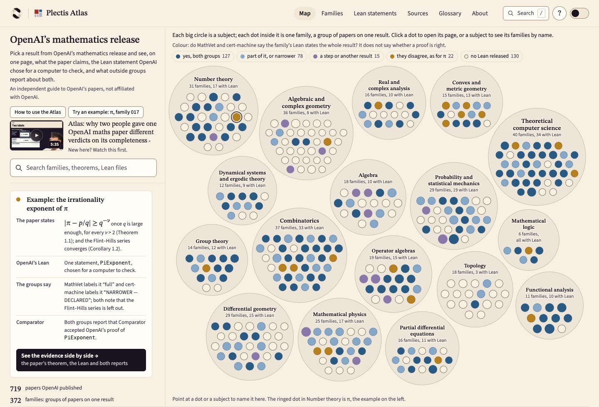
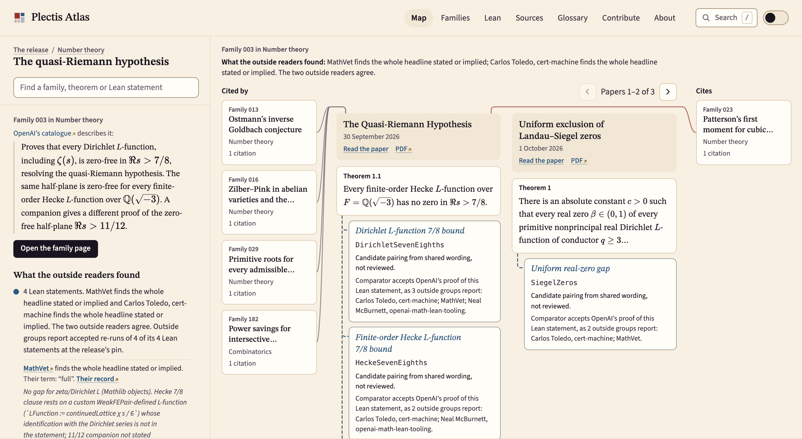
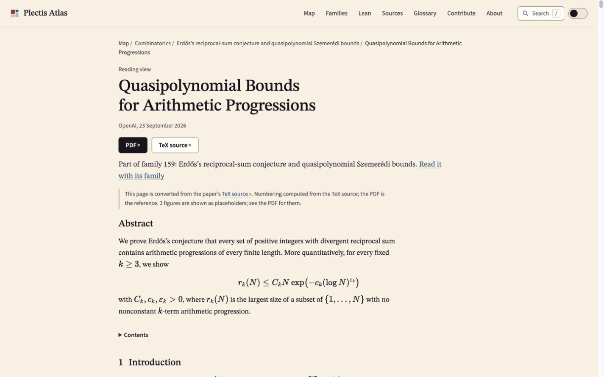

# Plectis Atlas

Plectis Atlas brings the papers in [OpenAI’s mathematics release](https://github.com/openai/math) alongside their formal statements and outside checking reports. Follow one result from the paper to what each group checked, without searching across repositories.

**[Explore the map](https://wcook04.github.io/plectis-atlas/)** · [Watch the walkthrough](https://www.youtube.com/watch?v=ugUObM3qpmM) · [Follow its π example](#one-paper-two-coverage-labels)

[Browse by subject](https://wcook04.github.io/plectis-atlas/explain.html) · [Build it locally](#build-it-yourself) · [Source map](#repository) · [Contribute](CONTRIBUTING.md)

Lean is software for writing mathematical statements and verifying proofs.
On each result's page, reports about a proof are separate from assessments of
whether its statement covers the paper's claims.

<a href="https://wcook04.github.io/plectis-atlas/">
  <picture>
    <source media="(prefers-color-scheme: dark)" srcset="docs/images/overview-dark.png">
    
  </picture>
</a>

*OpenAI’s release, grouped by discipline. Each dot is a “family”, OpenAI’s group of related papers. Colours show whether MathVet and cert-machine agree that the Lean statements express the advertised result. Outlines mark families with no Lean statement.*

The mathematics is OpenAI’s and the cited authors’ work. Independent assessments and reports of proof verification come from [MathVet](https://math.vet), [Carlos Toledo’s cert-machine](https://github.com/carlostoledo1891/cert-machine) and [Neal McBurnett’s Lean tooling](https://github.com/nealmcb/openai-math-lean-tooling). Atlas links their reports and has not repeated their work. [Sources and credits](https://wcook04.github.io/plectis-atlas/sources.html).

<a id="what-this-adds"></a>

## Why it exists

OpenAI’s release contains PDFs, their TeX typesetting source, a catalogue and Lean files. The relevant information is spread across them: the paper’s theorem, a possible Lean counterpart, OpenAI’s note on what the Lean statement expresses, and independent assessments or proof-verification reports. Atlas brings those sources onto each family’s page and links the papers that cite one another. Families without Lean remain visible. You can read the website without installing anything.

<a href="https://wcook04.github.io/plectis-atlas/families/003.html">
  <picture>
    <source media="(prefers-color-scheme: dark)" srcset="docs/images/family-dark.png">
    
  </picture>
</a>

*A family’s page: the claim beside what each group found, in their own words, with links to their records.*

## One paper, two coverage labels

Open the [paper family about the irrationality exponent of π](https://wcook04.github.io/plectis-atlas/families/017.html), also used in the [Atlas walkthrough](https://www.youtube.com/watch?v=ugUObM3qpmM). OpenAI’s description claims a result about approximating π by fractions and a consequence about convergence of the Flint Hills series. The selected Lean statement, `PiExponent`, includes the first claim and leaves out the second.

MathVet labels the coverage **full**, taking the π result as the headline, and notes that the series consequence is absent. Carlos Toledo’s cert-machine labels it **narrower and declared**, counting both claims and noting that OpenAI already identifies the omission. Their notes agree about what is missing even though their labels differ. MathVet describes its assessment as preliminary, before referee review.

Both groups also report that Comparator accepted OpenAI’s proof against `PiExponent`. That is a separate result: neither report checks the Flint Hills consequence. On the family page, you can read the paper and each group’s original report to see what its label means.

## What you can do

| Start here | What you get |
|---|---|
| [The map](https://wcook04.github.io/plectis-atlas/) | Browse disciplines and families, search for a theorem or paper, and follow citations. Each family shows its papers and possible matches between paper theorems and Lean statements. |
| [The reciprocal-sum family](https://wcook04.github.io/plectis-atlas/families/159.html) | The paper’s claim beside its linked Lean statement, OpenAI’s note on what that statement expresses, independent assessments and original proof-verification reports. |
| [A paper](https://wcook04.github.io/plectis-atlas/papers/Quasipolynomial-Bounds-for-Arithmetic-Progressions-September-23-2026.html) | A full reading page typeset from the paper’s TeX, with linked theorems, equations, cross-references and citations. Any conversion gap is listed on the page; the PDF stays the reference. |
| [A Lean statement](https://wcook04.github.io/plectis-atlas/statements/ErdosReciprocal.html) | The complete statement file, links to definitions that Atlas can identify, OpenAI’s proof of it in the release’s Lean library, proof-verification reports and possible paper matches. |
| [Who cites an author](https://wcook04.github.io/plectis-atlas/references-outside.html?cites=Duminil-Copin#find-citations) | Every paper in the release whose bibliography lists an author or a work, with the entry and the section that cites it. |
| [Sources and independent assessments](https://wcook04.github.io/plectis-atlas/sources.html) | Who compared the statements, verified proofs or calculated finite claims, with links to the original reports. |

<a href="https://wcook04.github.io/plectis-atlas/papers/Quasipolynomial-Bounds-for-Arithmetic-Progressions-September-23-2026.html">
  <picture>
    <source media="(prefers-color-scheme: dark)" srcset="docs/images/reader-dark.jpg">
    
  </picture>
</a>

*OpenAI’s paper, displayed in Atlas, with its original PDF and TeX source beside it. Follow its family link to the Lean statements and attributed outside readings. The PDF remains the reference.*

<!-- checks:start -->
Three independent groups report running [Comparator](https://github.com/leanprover/comparator) on the recorded release version: runs for 409 of the 416 statement files were accepted by at least one group, and 179 by all three. Comparator verifies the proof of a configured theorem; for files that configure only definitions, it compares their names and types. Acceptance does not establish that a statement means the same thing as the paper’s theorem. Two of them, [MathVet](https://math.vet) and Carlos Toledo’s [cert-machine](https://github.com/carlostoledo1891/cert-machine), also assessed whether every family’s Lean statements express the result OpenAI advertises, independently of each other. They agree on 220 of the 242 families both read and disagree on 22; each family page shows both readings.
<!-- checks:end -->

## The release in numbers

<!-- overview:start -->
| In the pinned release | Explore |
|---|---|
| **372 result families** across 17 disciplines | [Browse by subject](https://wcook04.github.io/plectis-atlas/explain.html) |
| **719 current manuscripts** | [Read the papers through their families](https://wcook04.github.io/plectis-atlas/explain.html) |
| **416 Lean statement files** | [Inspect the formal statements](https://wcook04.github.io/plectis-atlas/statements.html) |
| **16,077 resolved references** to work outside the collection | [Follow the citations](https://wcook04.github.io/plectis-atlas/references-outside.html) |
<!-- overview:end -->

All counts describe the release at the commit in [`upstream.json`](upstream.json). The site’s [Numbers page](https://wcook04.github.io/plectis-atlas/numbers.html) gives each number’s definition and the records behind it.

<details>
<summary>Full counts, coverage and reading-page checks</summary>

<!-- numbers:start -->
- **372 result families** in 17 disciplines, from **719 current manuscripts** (3 more were withdrawn and 27 earlier editions remain in the collection).
- **416 Lean statement files for Comparator**, 189 of them named in OpenAI's list of main results (200 entries). 242 families have an OpenAI note linking at least one statement file and explaining what it expresses, and those notes name 339 current manuscripts as accompanying papers.
- **10 statement files** use only Mathlib, Lean's mathematical library, and add no local definitions or notation. The median file adds 13 local declarations (definitions, structures, instances, notation and similar), and the largest (EditApproximation) adds 1,212. These determine what the formal statement means, so a comparison with the paper must include them.
- **386 manuscripts** cite other manuscripts in the collection (586 citation links in the current extraction; the Atlas baseline inventory counts 579). 217 of them cite at least one manuscript without associated Lean.
- **16,077 resolved references** to work outside the collection, which group automatically into 11,019 works (by DOI, then arXiv identifier, then title; the grouping is unaudited).
- The TeX sources of the current manuscripts contain 2,255 theorem, 4,745 proposition, 1,267 corollary and 12,397 lemma environments, repeated statements included.
- **AI-drafted comparisons.** Of 416 statement files, an AI agent classified 307 as stating a paper's theorem, 21 part of one, 28 a consequence, 24 a weaker form and 35 a supporting result; for 1 OpenAI's note leaves it unclear. The agent classified each file from OpenAI's note, quoting the note. No human review of these classifications is recorded.
- **Independent assessments.** [MathVet](https://math.vet) and Carlos Toledo's [cert-machine](https://github.com/carlostoledo1891/cert-machine) each assessed whether every family's Lean statements express the result OpenAI advertises, independently of OpenAI and of each other. Their findings, in their own terms, are on each family page and in the Families list.
- **Every paper in the browser.** 696 of the 719 current manuscripts have a full reading page made from their TeX, with formulas that KaTeX can typeset and links that resolve to their references, citations and theorems (figures are shown as placeholders); the other 23 have a reading page with a banner listing what did not convert. These tests validate the conversion, not the mathematics. They use the same KaTeX version as the site. The PDF stays the reference (`data/paper_acceptance.json`).

Counted by Statement Map from [openai/math at `fd4aeeb2ee4f`](https://github.com/openai/math/tree/fd4aeeb2ee4fc729c18d98444fed42fd0529eeeb), generation `fda4c3462963`. The unit, rule, state and credit behind each number, and its members, are on the site's Numbers page.
<!-- numbers:end -->

</details>

## One result, side by side

The [reciprocal-sum family](https://wcook04.github.io/plectis-atlas/families/159.html) shows how the pieces fit: Erdős’s conjecture that a set of positive integers whose reciprocals diverge contains arbitrarily long arithmetic progressions, the paper whose corollary states it, and the Lean statement OpenAI’s proof is checked against.

<details>
<summary>Read the paper’s statement, the Lean challenge and OpenAI’s scope note</summary>

<!-- example:start -->
**Family 159: Erdős’s reciprocal-sum conjecture and quasipolynomial Szemerédi bounds.** The paper, [*Quasipolynomial Bounds for Arithmetic Progressions*](https://github.com/openai/math/blob/fd4aeeb2ee4fc729c18d98444fed42fd0529eeeb/preprints/Quasipolynomial-Bounds-for-Arithmetic-Progressions-September-23-2026/paper.pdf), states:

> **Theorem** (label `ap:main`). For each fixed integer $k\ge3$ there are constants
> $C_k,c_k,\varepsilon_k>0$ such that, for every $N\ge2$,
> $$
>  r_k(N)\le C_kN\exp(-c_k(\log N)^{\varepsilon_k}).
> $$
> Equivalently, there is $A_k\ge1$ such that an $\alpha$-dense subset
> of $[N]$ contains a nonconstant $k$-term progression whenever
> $$
>  \log N\ge A_k(2+\log(1/\alpha))^{A_k},
>  \qquad 0<\alpha\le1.
> $$
>
> **Corollary** (label `ap:reciprocal`). Every set $A\subseteq\mathbb N$ with $\sum_{a\in A}a^{-1}=\infty$ contains nonconstant arithmetic progressions of every finite length.

The Lean statement [`ErdosReciprocal`](https://github.com/openai/math/blob/fd4aeeb2ee4fc729c18d98444fed42fd0529eeeb/lean/ComparatorChallenges/ErdosReciprocal.lean), the fixed statement Comparator checks OpenAI's proof against when it is run (3 local vocabulary declarations; allowed axioms `propext`, `Quot.sound`, `Classical.choice`; no definition holes):

```lean
def HasAP (A : Set ℕ) (k : ℕ) : Prop :=
  ∃ a d : ℕ, 0 < d ∧ ∀ i < k, a + i * d ∈ A
noncomputable def reciprocalTerm (A : Set ℕ) (n : ℕ) : ℝ := by
  classical
  exact if n ∈ A then (n : ℝ)⁻¹ else 0
def ReciprocalProgressionTheorem : Prop :=
  ∀ A : Set ℕ, ¬ Summable (reciprocalTerm A) → ∀ k : ℕ, HasAP A k
theorem manuscriptReciprocalProgressionTheorem : ReciprocalProgressionTheorem := by
  sorry
```

This challenge file leaves the proof as `sorry` by design. OpenAI's proof lives in the solution module `OAI.Combinatorics.Progressions.Main`, and if Comparator accepts a run, the proof establishes exactly the statement above using only the allowed axioms. MathVet and Neal McBurnett report re-running Comparator on it and accepting the proof.

OpenAI's scope note for this family:

> Erdős's reciprocal-sum conjecture asks whether every set of positive integers with divergent reciprocal sum contains arithmetic progressions of every finite length. The formalization proves this statement: for every requested length, such a set contains a progression with positive common difference. The selected theorem is the reciprocal-sum consequence. The paper's quantitative upper bound for the largest progression-free subset of $\{1,\ldots,N\}$ is outside this statement.
<!-- example:end -->

</details>

A successful proof check establishes the formal statement it checked. Whether that statement matches the paper is a separate judgement. Re-runs and readings are credited to the people who report them. Pairings the atlas proposed automatically, and scope readings an AI agent drafted, are labelled as such until a person reviews them. For a paper’s reading page, the PDF stays the reference.

## Read the website as an agent

The [website and map are agent-navigable](https://wcook04.github.io/plectis-atlas/agents.md). Start with [llms.txt](https://wcook04.github.io/plectis-atlas/llms.txt), then fetch the map's [overview](https://wcook04.github.io/plectis-atlas/data/universe-data.json) and [parts](https://wcook04.github.io/plectis-atlas/data/universe-parts.json) JSON. They expose every map node and its relationships, with stable source IDs, page links and a shared generation. The guide explains the index joins and includes a runnable Python traversal.

```sh
curl --fail --location https://wcook04.github.io/plectis-atlas/llms.txt
curl --fail --location https://wcook04.github.io/plectis-atlas/agents.md
```

No browser or JavaScript is needed. These static text routes reuse the map's existing exports and add no data request to a human page load. Preserve the source pin and evidence labels: citations are not proof dependencies, and candidate paper-to-Lean pairings remain unreviewed.

## Contribute

Pick a passage you are reading and say what is wrong, unclear or missing, with its location and what you checked. You can [open a note](https://github.com/wcook04/plectis-atlas/issues/new?template=report-a-problem.yml) from the browser. Accepted contributions are credited beside the work they improve.

Agents can file [unreviewed source, rendering, navigation or reproduction observations](https://github.com/wcook04/plectis-atlas/issues/new?template=agent-observation.yml) from a disclosed public account when their operator and platform permit it. Include the exact source and page, revision, checks and uncertainty; this issue route does not claim human review.

For more, [explain a result](skills/explain-a-result/SKILL.md), [compare a statement with its paper](skills/check-a-statement/SKILL.md), [trace an earlier source](skills/trace-a-credit/SKILL.md) or [replay a proof check](skills/replay-a-proof/SKILL.md). The [contributor guide](CONTRIBUTING.md) covers formats, credit and review.

**Working with an agent?** Open this repository in Codex, Claude Code or Cursor and ask it to start with [`start-here`](skills/start-here/SKILL.md); the [agent instructions](AGENTS.md) route each task to its skill. A named person stands behind each signed contribution and says how AI was used.

## Repository

| Folder | What lives here |
|---|---|
| [contributions/](contributions/) | Explanations, statement checks, credits and replay receipts |
| [curated/](curated/) | Attributed outside reports and draft scope readings |
| [backend/](backend/) | Pinned evidence records exported by Statement Map |
| [data/](data/) | Generated source indexes and paper-rendering metadata |
| [site/](site/README.md) | Page copy, styles and browser code |
| [scripts/](scripts/README.md) | Builders, importers and checks; regression suites in `scripts/tests/` |
| [docs/images/](docs/images/) | Light and dark README screenshots |
| [docs/](docs/README.md) | Documentation index and architecture guide |
| [skills/](skills/) | Task instructions for coding agents |
| [.github/ISSUE_TEMPLATE/](.github/ISSUE_TEMPLATE/) | Issue forms for reader notes and unreviewed agent observations |

The [documentation index](docs/README.md) collects the guides for contributors and developers.
`python3 scripts/check_repository_structure.py` enforces these roles in CI; it checks
Git candidates, including staged additions, while ignoring generated website output.

<a id="build-it-yourself"></a>

## How it is built

The site is static: Python builds it from a pinned commit of OpenAI’s release and a checked-in export from **Statement Map**, the separate backend that joins papers, Lean statements, citations and outside reports. Its [export is included here](backend/EXPORT.json), so you can rebuild the site without running the backend. The site builders check data integrity and page rendering; they do not run Lean or Comparator.

Papers are typeset in the browser with KaTeX. The build checks formula conversion with the same KaTeX version the site loads; conversion acceptance is separate from checking the mathematics. Reading the published site needs no installation or account.

For a complete local copy, install **Python 3.10 or newer, Git and Node.js**. The core scripts use Python’s standard library, and KaTeX is included; there is no `pip install` or `npm install` step. The source-fetch step needs a network connection and creates a sibling `openai-math-upstream` checkout.

```sh
git clone https://github.com/wcook04/plectis-atlas
cd plectis-atlas
python3 scripts/reader.py
sh scripts/fetch_upstream.sh
python3 scripts/build_site.py
python3 scripts/build_papers.py --jobs 2
python3 scripts/build_universe.py
python3 scripts/check_paper_links.py site/_build
python3 -m http.server -d site/_build
```

Open [localhost:8000](http://localhost:8000). Keep that build order: `build_site.py` clears its output before the paper reader adds its pages. To work on copy or layout without downloading paper sources, use the [quick preview](docs/ARCHITECTURE.md#quick-preview-without-paper-sources). The [architecture guide](docs/ARCHITECTURE.md) explains the data boundaries, metadata refresh and checks.

## For producers of formal mathematics

If you release Lean alongside papers, [the alignment proposal](ALIGNMENT.md) describes optional `formalization.yaml` fields for linking each printed claim to its Lean declaration. It also describes how readers can return checked work to you.

<a id="sources-related-work-and-motivation"></a>

## Credits and related work

The atlas reads [OpenAI’s release](https://github.com/openai/math) and brings in the work of [MathVet](https://math.vet), Carlos Toledo’s [cert-machine](https://github.com/carlostoledo1891/cert-machine) and Neal McBurnett’s [Lean tooling](https://github.com/nealmcb/openai-math-lean-tooling). Each finding is credited where it is shown, with a link to the source’s own record; the [Sources page](https://wcook04.github.io/plectis-atlas/sources.html) lists them all and [NOTICE](NOTICE) records imported material and licences.

<details>
<summary>Related projects and the writing behind the design</summary>

| Project | Its work and the atlas’s use of it |
| --- | --- |
| [OpenAI mathematics release](https://github.com/openai/math) | The papers, catalogue, scope notes, formal statements and release history the atlas reads. Every page links back to the pinned source. |
| [MathVet](https://github.com/mathvet/mathvet), Carlos Toledo’s [cert-machine](https://github.com/carlostoledo1891/cert-machine) and Neal McBurnett’s [Lean tooling](https://github.com/nealmcb/openai-math-lean-tooling) | Outside statement readings and reported re-runs, shown in their own terms with their scope and disagreements. |
| [Comparator](https://github.com/leanprover/comparator) | The tool that checks a solution against its challenge statement in the reported re-runs. Building this website does not run it. |
| [formalization.yaml](https://github.com/mathlib-initiative/formalization.yaml) | The metadata standard the alignment proposal builds on. |
| Patrick Massot’s [leanblueprint](https://github.com/PatrickMassot/leanblueprint) | Authoring infrastructure that links a project’s informal blueprint to its Lean as the project is written. |
| [Cited by AGI](https://citedbyagi.com/) | Traces the bibliographic citations in the release. |

Henry Cohn’s [essay on the technical debt of AI-generated mathematics](https://terrytao.wordpress.com/2026/09/15/the-technical-debt-of-ai-generated-mathematics/) argues for explanations a reader can reconstruct and use. Thomas Hales’s [account of Lean’s reliability](https://terrytao.wordpress.com/2026/10/09/what-mathematicians-should-know-about-the-lean-theorem-proverquestions-of-reliability-and-ai/) separates checking a proof from deciding what a formal statement means. [Responsible Release of AI-Generated Mathematics](https://agmai.org/general-sep29/) asks for attribution, clear exposition and support for human understanding. They inform the emphasis on readable explanations, attribution and careful interpretation of formal statements. None is an endorsement or review of this atlas. The [About page](https://wcook04.github.io/plectis-atlas/about.html) says more.

</details>

## Videos and related projects

In the [Atlas walkthrough](https://www.youtube.com/watch?v=ugUObM3qpmM),
Will opens the paper about π and compares MathVet's and Carlos Toledo's
cert-machine reports. You can follow the same example at your own pace:

- [Read the comparison above](#one-paper-two-coverage-labels).
- [Open family 017](https://wcook04.github.io/plectis-atlas/families/017.html) for the paper, selected Lean statement and original reports.
- [Read the source and citation guide](docs/ATTRIBUTION.md) before reusing a result or assessment.

The [Plectis introduction](https://www.youtube.com/watch?v=U1z2-XaLe_w)
explains the wider maths and software projects.

### Where Atlas fits

Plectis is Will Cook’s programme of research and software built with AI agents. The aim is to make the resulting work understandable enough for other people to inspect, question and build on. Atlas applies that approach to other authors’ mathematics, keeping the original papers and outside assessments attributed.

| Related project | Why follow it |
| --- | --- |
| [Plectis Erdős](https://github.com/wcook04/plectis-erdos) · [research website](https://wcook04.github.io/practical-formal-verification/maths/) | The original eight-problem research corpus whose paper-to-Lean records informed Atlas. |
| [Plectis Erdős Lean](https://github.com/wcook04/plectis-erdos-lean) | Lean proofs and Comparator checks for selected results from that corpus. |

The [Plectis website](https://wcook04.github.io/practical-formal-verification/) collects all the projects
and videos. The separate [Plectis toolkit](https://github.com/wcook04/practical-formal-verification)
contains Python experiments; this repository contains the Atlas website and its builders.

## Licences and independence

Report vulnerabilities through the [private security route](SECURITY.md).

Plectis Atlas is independent of OpenAI and is not affiliated with or endorsed by it. Quoted release material is copyright OpenAI, reproduced under Apache-2.0 from the pinned source. Original Atlas code and documentation are Apache-2.0; contributed explanations are CC BY 4.0. Imported material retains its own terms, including MIT and SIL Open Font License components. See [the licence](LICENSE), [attribution notice](NOTICE) and [source and citation guide](docs/ATTRIBUTION.md).

## Author

Made by [Will Cook](https://wcook04.github.io/practical-formal-verification/). The atlas grew out of the paper-to-Lean records built for [Plectis’s research on eight Erdős problems](https://wcook04.github.io/practical-formal-verification/maths/). The results it shows belong to their authors. To cite the atlas, use [`CITATION.cff`](CITATION.cff). Cite the original paper or outside report as well when relying on its result; the Atlas citation does not replace those credits.
