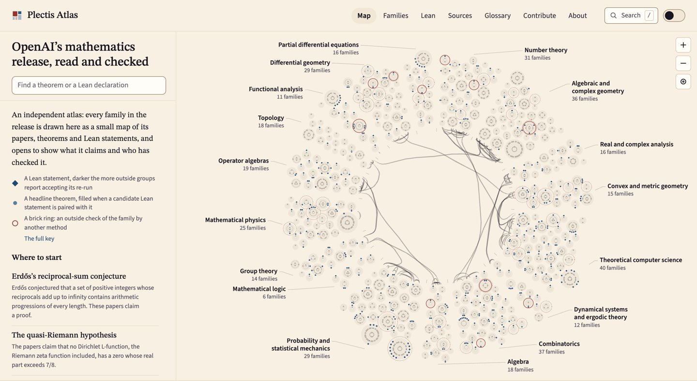

# Plectis Atlas

An independent reader for [OpenAI’s mathematics release](https://github.com/openai/math). Read the papers in your browser, compare their claims with the linked Lean statements, and follow checks credited to the people who ran them.

**[Open the atlas ↗](https://wcook04.github.io/plectis-atlas/)** &nbsp; [Browse the families](https://wcook04.github.io/plectis-atlas/explain.html) &nbsp; [Contribute](CONTRIBUTING.md) &nbsp; [How it is built](docs/ARCHITECTURE.md)

<a href="https://wcook04.github.io/plectis-atlas/">
  <picture>
    <source media="(prefers-color-scheme: dark)" srcset="docs/map-dark.png">
    
  </picture>
</a>

*The whole release on one map. Point at a family to see what it is about; click to open it.*

<a id="what-this-adds"></a>

## Why it exists

OpenAI’s release is a Git repository of PDFs, TeX sources, a catalogue and Lean files. OpenAI groups related results into **families**. Each family page brings together its papers, any linked Lean statements, OpenAI’s note on what those statements cover, and what outside groups found when they checked them. The map includes families without Lean and keeps disagreements visible. You can read it without installing anything.

## What you can do

| Start here | What you get |
|---|---|
| [The map](https://wcook04.github.io/plectis-atlas/) | Explore by discipline, search for a theorem or Lean name, and open a family to follow its papers and statements. |
| [The reciprocal-sum family](https://wcook04.github.io/plectis-atlas/families/159.html) | The paper’s claim beside its linked Lean statement, OpenAI’s scope note, outside readings and reported re-runs with their receipts. |
| [A paper](https://wcook04.github.io/plectis-atlas/papers/Quasipolynomial-Bounds-for-Arithmetic-Progressions-September-23-2026.html) | A reading page made from the paper’s TeX, with linked statements and references. Conversion gaps are listed on the page; the PDF remains the reference. |
| [A Lean statement](https://wcook04.github.io/plectis-atlas/statements/ErdosReciprocal.html) | The challenge file, links to definitions and source code, reported checks, and candidate matches to paper statements. |
| [Sources and outside readings](https://wcook04.github.io/plectis-atlas/sources.html) | Who checked what, in their own words, with links to their records. |

Three outside groups report re-running OpenAI’s proofs through [Comparator](https://github.com/leanprover/comparator). Two of them, [MathVet](https://math.vet) and Carlos Toledo’s [cert-machine](https://github.com/carlostoledo1891/cert-machine), also compare the families’ Lean statements with their headline results. Each family page shows both readings, including disagreements. The [Numbers page](https://wcook04.github.io/plectis-atlas/numbers.html) gives the reported coverage and the records behind it.

## The release in numbers

<!-- overview:start -->
| In the pinned release | Explore |
|---|---|
| **372 result families** across 17 disciplines | [Browse by subject](https://wcook04.github.io/plectis-atlas/explain.html) |
| **719 current manuscripts** | [Read the papers through their families](https://wcook04.github.io/plectis-atlas/explain.html) |
| **416 Lean challenge files** | [Inspect the formal statements](https://wcook04.github.io/plectis-atlas/statements.html) |
| **16,077 resolved references** to work outside the collection | [Follow the citations](https://wcook04.github.io/plectis-atlas/references-outside.html) |
<!-- overview:end -->

All counts describe the release at the commit in [`upstream.json`](upstream.json). The site’s [Numbers page](https://wcook04.github.io/plectis-atlas/numbers.html) gives each number’s definition and the records behind it.

<details>
<summary>Full counts, coverage and reading-page checks</summary>

<!-- numbers:start -->
- **372 result families** in 17 disciplines, from **719 current manuscripts** (3 more were withdrawn and 27 earlier editions remain in the collection).
- **416 Comparator challenge files**, 189 of them named in OpenAI's list of main results (200 declarations). 242 families have a Lean scope note linking at least one challenge file, and those notes name 339 current manuscripts as accompanying papers.
- **10 challenge files** import only Mathlib and add no local vocabulary. The median file adds 13 local vocabulary declarations (definitions, structures, instances, notation and similar), and the largest (EditApproximation) adds 1,212. Each one is part of what the statement means, so a reader checks it against the paper.
- **386 manuscripts** cite other manuscripts in the collection (586 citation links in the current extraction; the Atlas baseline inventory counts 579). 217 of them cite at least one manuscript without associated Lean.
- **16,077 resolved references** to work outside the collection, which group automatically into 11,019 works (by DOI, then arXiv identifier, then title; the grouping is unaudited).
- The TeX sources of the current manuscripts contain 2,255 theorem, 4,745 proposition, 1,267 corollary and 12,397 lemma environments, repeated statements included.
- **Draft scope reading.** Of 416 challenge files, an AI agent drafted 307 as stating a paper's headline theorem, 21 part of one, 28 a consequence, 24 a weaker form and 35 a supporting result; for 1 OpenAI's note leaves it unclear. The agent classified each file from OpenAI's scope note, quoting the note; no person has reviewed it.
- **Outside readers.** [MathVet](https://math.vet) and Carlos Toledo's [cert-machine](https://github.com/carlostoledo1891/cert-machine) each read every family's Lean against its headline, independently of OpenAI and of each other. Their findings, in their own terms, are on each family page and in the Families list.
- **Every paper in the browser.** 683 of the 719 current manuscripts have a full reading page made from their TeX, with every formula, cross-reference, citation and theorem anchor checked (figures are shown as placeholders); the other 36 have a reading page with a banner listing what did not convert. Formulas are checked with the KaTeX version the site loads. The PDF stays the reference (`data/paper_acceptance.json`).

Counted by Statement Map from [openai/math at `fd4aeeb2ee4f`](https://github.com/openai/math/tree/fd4aeeb2ee4fc729c18d98444fed42fd0529eeeb), generation `c2164a5394dc`. The unit, rule, state and credit behind each number, and its members, are on the site's Numbers page.
<!-- numbers:end -->

</details>

## One result, side by side

The [reciprocal-sum family](https://wcook04.github.io/plectis-atlas/families/159.html) shows how the pieces fit: Erdős’s conjecture that a set of positive integers whose reciprocals diverge contains arbitrarily long arithmetic progressions, the paper whose corollary states it, and the Lean statement OpenAI’s proof is checked against.

<details>
<summary>Read the paper’s statement, the Lean challenge and OpenAI’s scope note</summary>

<!-- example:start -->
**Family 159: Erdős’s reciprocal-sum conjecture and quasipolynomial Szemerédi bounds.** The paper, [*Quasipolynomial Bounds for Arithmetic Progressions*](https://github.com/openai/math/blob/fd4aeeb2ee4fc729c18d98444fed42fd0529eeeb/preprints/Quasipolynomial-Bounds-for-Arithmetic-Progressions-September-23-2026/paper.pdf), states:

> **Theorem** (label `ap:main`). For each fixed integer $k\ge3$ there are constants
> $C_k,c_k,\varepsilon_k>0$ such that, for every $N\ge2$,
> $$
>  r_k(N)\le C_kN\exp(-c_k(\log N)^{\varepsilon_k}).
> $$
> Equivalently, there is $A_k\ge1$ such that an $\alpha$-dense subset
> of $[N]$ contains a nonconstant $k$-term progression whenever
> $$
>  \log N\ge A_k(2+\log(1/\alpha))^{A_k},
>  \qquad 0<\alpha\le1.
> $$
>
> **Corollary** (label `ap:reciprocal`). Every set $A\subseteq\mathbb N$ with $\sum_{a\in A}a^{-1}=\infty$ contains nonconstant arithmetic progressions of every finite length.

The Lean statement [`ErdosReciprocal`](https://github.com/openai/math/blob/fd4aeeb2ee4fc729c18d98444fed42fd0529eeeb/lean/ComparatorChallenges/ErdosReciprocal.lean), the fixed statement Comparator checks OpenAI's proof against when it is run (3 local vocabulary declarations; allowed axioms `propext`, `Quot.sound`, `Classical.choice`; no definition holes):

```lean
def HasAP (A : Set ℕ) (k : ℕ) : Prop :=
  ∃ a d : ℕ, 0 < d ∧ ∀ i < k, a + i * d ∈ A
noncomputable def reciprocalTerm (A : Set ℕ) (n : ℕ) : ℝ := by
  classical
  exact if n ∈ A then (n : ℝ)⁻¹ else 0
def ReciprocalProgressionTheorem : Prop :=
  ∀ A : Set ℕ, ¬ Summable (reciprocalTerm A) → ∀ k : ℕ, HasAP A k
theorem manuscriptReciprocalProgressionTheorem : ReciprocalProgressionTheorem := by
  sorry
```

This challenge file leaves the proof as `sorry` by design. OpenAI's proof lives in the solution module `OAI.Combinatorics.Progressions.Main`, and if Comparator accepts a run, the proof establishes exactly the statement above using only the allowed axioms. MathVet and Neal McBurnett report re-running Comparator on it and accepting the proof.

OpenAI's scope note for this family:

> Erdős's reciprocal-sum conjecture asks whether every set of positive integers with divergent reciprocal sum contains arithmetic progressions of every finite length. The formalization proves this statement: for every requested length, such a set contains a progression with positive common difference. The selected theorem is the reciprocal-sum consequence. The paper's quantitative upper bound for the largest progression-free subset of $\{1,\ldots,N\}$ is outside this statement.
<!-- example:end -->

</details>

A successful proof check establishes the formal statement it checked. Whether that statement matches the paper is a separate judgement. Re-runs and readings are credited to the people who report them. Pairings the atlas proposed automatically, and scope readings an AI agent drafted, are labelled as such until a person reviews them. For a paper’s reading page, the PDF stays the reference.

## Contribute

Pick a passage you are reading and say what is wrong, unclear or missing, with its location and what you checked. You can [open a note](https://github.com/wcook04/plectis-atlas/issues/new?template=report-a-problem.yml) from the browser. Accepted contributions are credited beside the work they improve.

For more, [explain a result](skills/explain-a-result/SKILL.md), [compare a statement with its paper](skills/check-a-statement/SKILL.md), [trace an earlier source](skills/trace-a-credit/SKILL.md) or [replay a proof check](skills/replay-a-proof/SKILL.md). The [contributor guide](CONTRIBUTING.md) covers formats, credit and review.

**Working with an agent?** Open this repository in Codex, Claude Code or Cursor and ask it to start with [`start-here`](skills/start-here/SKILL.md); the [agent instructions](AGENTS.md) route each task to its skill. A named person stands behind each contribution and says how AI was used.

## Repository

| Folder | What lives here |
|---|---|
| [contributions/](contributions/) | Explanations, statement checks, credits and replay receipts |
| [curated/](curated/) | Attributed outside reports and draft scope readings |
| [backend/](backend/) | Pinned evidence records exported by Statement Map |
| [data/](data/) | Generated source indexes and paper-rendering metadata |
| [site/](site/README.md) | Page copy, styles and browser code |
| [scripts/](scripts/README.md) | Builders, importers and checks |
| [docs/](docs/README.md) | Documentation index and architecture guide |
| [skills/](skills/) | Task instructions for coding agents |

The [documentation index](docs/README.md) collects the guides for contributors and developers.

<a id="build-it-yourself"></a>

## How it is built

The site is static: Python builds it from a pinned commit of OpenAI’s release and a checked-in export from **Statement Map**, the separate backend that joins papers, Lean statements, citations and outside reports. Its [export is included here](backend/EXPORT.json), so you can rebuild the site without running the backend. The site builders check data integrity and page rendering; they do not run Lean or Comparator.

Start with the [quick local preview](docs/ARCHITECTURE.md#quick-preview-without-paper-sources), or follow the [complete build](docs/ARCHITECTURE.md#rebuilding-the-website) to include the full paper reading pages. The core builders need Python 3.10 or newer. Git fetches paper sources; Node checks formulas with the included KaTeX.

## For producers of formal mathematics

If you release Lean alongside papers, [the alignment proposal](ALIGNMENT.md) describes optional `formalization.yaml` fields for linking each printed claim to its Lean declaration. It also describes how readers can return checked work to you.

<a id="sources-related-work-and-motivation"></a>

## Credits and related work

The atlas reads [OpenAI’s release](https://github.com/openai/math) and brings in the work of [MathVet](https://math.vet), Carlos Toledo’s [cert-machine](https://github.com/carlostoledo1891/cert-machine) and Neal McBurnett’s [Lean tooling](https://github.com/nealmcb/openai-math-lean-tooling). Each finding is credited where it is shown, with a link to the source’s own record; the [Sources page](https://wcook04.github.io/plectis-atlas/sources.html) lists them all and [NOTICE](NOTICE) records imported material and licences.

<details>
<summary>Related projects and the writing behind the design</summary>

| Project | Its work and the atlas’s use of it |
| --- | --- |
| [OpenAI mathematics release](https://github.com/openai/math) | The papers, catalogue, scope notes, formal statements and release history the atlas reads. Every page links back to the pinned source. |
| [MathVet](https://github.com/mathvet/mathvet), Carlos Toledo’s [cert-machine](https://github.com/carlostoledo1891/cert-machine) and Neal McBurnett’s [Lean tooling](https://github.com/nealmcb/openai-math-lean-tooling) | Outside statement readings and reported re-runs, shown in their own terms with their scope and disagreements. |
| [Comparator](https://github.com/leanprover/comparator) | The tool that checks a solution against its challenge statement in the reported re-runs. Building this website does not run it. |
| [formalization.yaml](https://github.com/mathlib-initiative/formalization.yaml) | The metadata standard the alignment proposal builds on. |
| Patrick Massot’s [leanblueprint](https://github.com/PatrickMassot/leanblueprint) | Authoring infrastructure that links a project’s informal blueprint to its Lean as the project is written. |
| [Cited by AGI](https://citedbyagi.com/) | Traces the bibliographic citations in the release. |

Henry Cohn’s [essay on the technical debt of AI-generated mathematics](https://terrytao.wordpress.com/2026/09/15/the-technical-debt-of-ai-generated-mathematics/) argues for explanations a reader can reconstruct and use. Thomas Hales’s [account of Lean’s reliability](https://terrytao.wordpress.com/2026/10/09/what-mathematicians-should-know-about-the-lean-theorem-proverquestions-of-reliability-and-ai/) separates checking a proof from deciding what a formal statement means. [Responsible Release of AI-Generated Mathematics](https://agmai.org/general-sep29/) asks for attribution, clear exposition and support for human understanding. They inform the emphasis on readable explanations, attribution and careful interpretation of formal statements. None is an endorsement or review of this atlas. The [About page](https://wcook04.github.io/plectis-atlas/about.html) says more.

</details>

## Licences and independence

Plectis Atlas is independent of OpenAI and is not affiliated with or endorsed by it. Quoted release material is copyright OpenAI, reproduced under Apache-2.0 from the pinned source. Atlas code, data and documentation are Apache-2.0; contributed explanations are CC BY 4.0. See [the licence](LICENSE) and [attribution notice](NOTICE).

## Author

Made by [Will Cook](https://wcook04.github.io/plectis/). The atlas grew out of the paper-to-Lean records built for [Plectis’s research on eight Erdős problems](https://wcook04.github.io/plectis/maths/). The results it shows belong to their authors. To cite the atlas, use [`CITATION.cff`](CITATION.cff).
